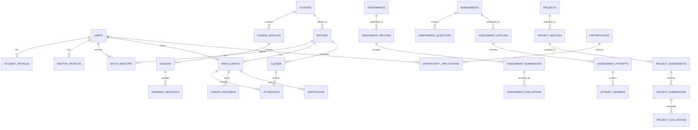

# CodeEmy LMS — proposed database tables and columns

**Planning document only. No database, tables, ORM, API, or migrations have been created.** This model covers the Student, Mentor, and Admin requirements in the supplied LMS brief.

Use one shared database. Do not create separate copies of courses or users for each role. A Student learns the same course that a Mentor teaches and an Admin manages.

The types below use PostgreSQL-style names to make the proposal concrete. PostgreSQL and an ORM have **not** been installed or selected for implementation.

## Read the column notation

| Notation                         | Meaning                                                                              |
| -------------------------------- | ------------------------------------------------------------------------------------ |
| `id: uuid PK`                    | Unique primary key identifying a row                                                 |
| `student_id: uuid FK → users.id` | Reference to another table's primary key                                             |
| `UQ`                             | Unique value/combination; duplicates are rejected                                    |
| `?`                              | Nullable/optional column                                                             |
| `text`                           | String, such as a title or description                                               |
| `integer`                        | Whole number                                                                         |
| `numeric(8,2)`                   | Number with two decimal places, useful for marks                                     |
| `boolean`                        | True/false                                                                           |
| `date`                           | Calendar date                                                                        |
| `timestamptz`                    | Timestamp with timezone; store UTC, display IST as needed                            |
| `jsonb`                          | Structured configuration/snapshot data, not a substitute for relational foreign keys |

Unless a row explicitly says otherwise, **every table below includes**:

```text
id          uuid PK
created_at  timestamptz NOT NULL DEFAULT now()
updated_at  timestamptz NOT NULL DEFAULT now()
```

`updated_at` must be maintained by the eventual application or a database trigger. Add `created_by` or `recorded_by` where the author matters, as shown below. Required columns are non-null unless marked `?`.

Statuses and role values should use database CHECK constraints or enums. Their names are shown in the rules column.

## 1. Users and profiles — 4 tables

Exactly three application roles: `student`, `mentor`, `admin`. A `users.role` column is sufficient; a separate role/permission subsystem is unnecessary for this scope.

| Table              | Purpose                             | Additional columns                                                                                                                                                                                                               | Rules                                                                                                                                                             |
| ------------------ | ----------------------------------- | -------------------------------------------------------------------------------------------------------------------------------------------------------------------------------------------------------------------------------- | ----------------------------------------------------------------------------------------------------------------------------------------------------------------- |
| `users`            | Shared identity for all three roles | `full_name: text`, `email: text UQ`, `password_hash: text?`, `role: text`, `phone: text?`, `avatar_file_id: uuid? FK → media_files.id`, `status: text`, `last_login_at: timestamptz?`                                            | Role: student/mentor/admin. Status: active/inactive. Normalize email before checking uniqueness. Password hash is future auth data; never store a plain password. |
| `student_profiles` | Student-specific profile            | `user_id: uuid UQ FK → users.id`, `student_code: text UQ`, `date_of_birth: date?`, `education: text?`, `location: text?`, `bio: text?`, `github_url: text?`, `portfolio_url: text?`, `resume_file_id: uuid? FK → media_files.id` | Referenced user must have Student role.                                                                                                                           |
| `mentor_profiles`  | Mentor-specific profile             | `user_id: uuid UQ FK → users.id`, `mentor_code: text UQ`, `headline: text?`, `bio: text?`, `expertise: text[]`, `experience_years: integer`, `office_hours: text?`                                                               | Referenced user must have Mentor role. Experience ≥ 0.                                                                                                            |
| `user_preferences` | Profile/settings preferences        | `user_id: uuid UQ FK → users.id`, `timezone: text`, `email_notifications: boolean`, `learning_reminders: boolean`                                                                                                                | One preference row per user. Default timezone Asia/Kolkata.                                                                                                       |

No `admin_profiles` table is needed while the Admin profile uses only shared identity fields.

## 2. Courses and learning content — 5 tables

| Table                | Purpose                                  | Additional columns                                                                                                                                                                                                                      | Rules                                                                                                                                                |
| -------------------- | ---------------------------------------- | --------------------------------------------------------------------------------------------------------------------------------------------------------------------------------------------------------------------------------------- | ---------------------------------------------------------------------------------------------------------------------------------------------------- |
| `courses`            | Course definition                        | `title: text`, `slug: text UQ`, `description: text`, `category: text`, `level: text?`, `thumbnail_file_id: uuid? FK → media_files.id`, `status: text`, `created_by: uuid FK → users.id`                                                 | Status: draft/published/archived. Course dates belong to a batch because the same course can run many times.                                         |
| `course_modules`     | Modules inside a course                  | `course_id: uuid FK → courses.id`, `title: text`, `description: text?`, `sort_order: integer`, `status: text`                                                                                                                           | UQ(course_id, sort_order). Status: draft/published.                                                                                                  |
| `lessons`            | Ordered lessons inside a module          | `module_id: uuid FK → course_modules.id`, `title: text`, `description: text?`, `lesson_type: text`, `video_file_id: uuid? FK → media_files.id`, `video_url: text?`, `duration_seconds: integer?`, `sort_order: integer`, `status: text` | UQ(module_id, sort_order). Type: video/material/activity. Duration ≥ 0. Do not duplicate course_id; derive it through module_id.                     |
| `media_files`        | Metadata for uploaded files              | `uploaded_by: uuid FK → users.id`, `original_name: text`, `storage_key: text UQ`, `mime_type: text`, `size_bytes: bigint`, `status: text`                                                                                               | Store files in future object/file storage; store metadata here. Status: pending/available/quarantined/deleted. Validate size/type server-side later. |
| `learning_materials` | Video/PDF/PPT/document/link for a lesson | `lesson_id: uuid FK → lessons.id`, `title: text`, `material_type: text`, `file_id: uuid? FK → media_files.id`, `external_url: text?`, `sort_order: integer`, `created_by: uuid FK → users.id`                                           | Type: video/pdf/ppt/document/external. Require exactly one of file_id or external_url.                                                               |

## 3. Batches and enrollments — 3 tables

| Table           | Purpose                          | Additional columns                                                                                                                                                                   | Rules                                                                                                                                                |
| --------------- | -------------------------------- | ------------------------------------------------------------------------------------------------------------------------------------------------------------------------------------ | ---------------------------------------------------------------------------------------------------------------------------------------------------- |
| `batches`       | A scheduled offering of a course | `course_id: uuid FK → courses.id`, `name: text`, `batch_code: text UQ`, `start_date: date`, `end_date: date`, `capacity: integer?`, `status: text`, `created_by: uuid FK → users.id` | Status: upcoming/active/completed/cancelled. End ≥ start. Capacity > 0 when present.                                                                 |
| `batch_mentors` | Assign mentors to batches        | `batch_id: uuid FK → batches.id`, `mentor_id: uuid FK → users.id`, `is_primary: boolean`, `assigned_by: uuid FK → users.id`, `assigned_at: timestamptz`, `ended_at: timestamptz?`    | Only Mentor users. Partial UQ(batch_id, mentor_id) for active assignments; at most one active primary mentor per batch. Preserve assignment history. |
| `enrollments`   | Assign a student to a batch      | `batch_id: uuid FK → batches.id`, `student_id: uuid FK → users.id`, `enrolled_at: timestamptz`, `status: text`, `completed_at: timestamptz?`, `assigned_by: uuid FK → users.id`      | UQ(batch_id, student_id). Only Student users. Status: enrolled/active/completed/withdrawn. Course is derived from batch_id.                          |

My Courses uses enrollments → batches → courses. Mentor Courses uses batch_mentors → batches → courses. No redundant `student_courses` table is required.

## 4. Classes, attendance and progress — 3 tables

| Table             | Purpose                                | Additional columns                                                                                                                                                                                                                                              | Rules                                                                                                                                    |
| ----------------- | -------------------------------------- | --------------------------------------------------------------------------------------------------------------------------------------------------------------------------------------------------------------------------------------------------------------- | ---------------------------------------------------------------------------------------------------------------------------------------- |
| `classes`         | Scheduled class for a batch            | `batch_id: uuid FK → batches.id`, `mentor_id: uuid FK → users.id`, `lesson_id: uuid? FK → lessons.id`, `title: text`, `agenda: text?`, `starts_at: timestamptz`, `ends_at: timestamptz`, `meeting_url: text?`, `status: text`, `created_by: uuid FK → users.id` | Status: scheduled/completed/cancelled. End > start. Mentor must be assigned to batch; optional lesson must belong to the batch's course. |
| `attendance`      | One student's attendance for one class | `class_id: uuid FK → classes.id`, `enrollment_id: uuid FK → enrollments.id`, `status: text`, `notes: text?`, `recorded_by: uuid FK → users.id`, `recorded_at: timestamptz`                                                                                      | UQ(class_id, enrollment_id). Status: present/absent/late/excused. Class and enrollment must share batch_id.                              |
| `lesson_progress` | Student lesson completion              | `enrollment_id: uuid FK → enrollments.id`, `lesson_id: uuid FK → lessons.id`, `status: text`, `last_video_position_seconds: integer`, `started_at: timestamptz?`, `completed_at: timestamptz?`                                                                  | UQ(enrollment_id, lesson_id). Status: not_started/in_progress/completed. Lesson must belong to enrollment's course.                      |

Calculate attendance and module/course percentages from these records. Define the academic policy explicitly: for example, present and late count as attended, excused classes are excluded from the denominator, cancelled classes are excluded, and missing attendance is reported as unrecorded. There is no separate writable `dashboard_stats` or `progress_percentage` table.

## 5. Assignments — 5 tables

| Table                         | Purpose                            | Additional columns                                                                                                                                                                                                                   | Rules                                                                                                                                                         |
| ----------------------------- | ---------------------------------- | ------------------------------------------------------------------------------------------------------------------------------------------------------------------------------------------------------------------------------------ | ------------------------------------------------------------------------------------------------------------------------------------------------------------- |
| `assignments`                 | Assignment content                 | `course_id: uuid FK → courses.id`, `module_id: uuid? FK → course_modules.id`, `lesson_id: uuid? FK → lessons.id`, `title: text`, `instructions: text`, `max_marks: numeric(8,2)`, `status: text`, `created_by: uuid FK → users.id`   | Status: draft/published/archived. Max marks > 0. Optional module/lesson must belong to this course and be consistent with each other.                         |
| `assignment_batches`          | Publish an assignment to a batch   | `assignment_id: uuid FK → assignments.id`, `batch_id: uuid FK → batches.id`, `due_at: timestamptz`, `published_at: timestamptz?`, `allow_late_submission: boolean`                                                                   | UQ(assignment_id, batch_id). Batch must be for assignment's course. Due dates can differ by batch.                                                            |
| `assignment_submissions`      | A student's submission/revision    | `assignment_batch_id: uuid FK → assignment_batches.id`, `enrollment_id: uuid FK → enrollments.id`, `attempt_number: integer`, `notes: text?`, `status: text`, `submitted_at: timestamptz?`                                           | UQ(assignment_batch_id, enrollment_id, attempt_number). Status: draft/submitted/evaluated/resubmission_requested. Enrollment batch must match assigned batch. |
| `assignment_submission_files` | Files attached to a submission     | `submission_id: uuid FK → assignment_submissions.id`, `file_id: uuid FK → media_files.id`                                                                                                                                            | UQ(submission_id, file_id). File must be owned by the submitting student or authorized for that submission.                                                   |
| `assignment_evaluations`      | Marks, feedback and review history | `submission_id: uuid FK → assignment_submissions.id`, `mentor_id: uuid FK → users.id`, `marks: numeric(8,2)`, `feedback: text`, `decision: text`, `evaluated_at: timestamptz`, `supersedes_id: uuid? FK → assignment_evaluations.id` | Decision: approved/rejected/resubmission. 0 ≤ marks ≤ assignment max_marks. New re-evaluations append a row; latest evaluation is displayed.                  |

## 6. Assessments and question bank — 8 tables

| Table                     | Purpose                                         | Additional columns                                                                                                                                                                                                                                                           | Rules                                                                                                                                                                                                                                    |
| ------------------------- | ----------------------------------------------- | ---------------------------------------------------------------------------------------------------------------------------------------------------------------------------------------------------------------------------------------------------------------------------- | ---------------------------------------------------------------------------------------------------------------------------------------------------------------------------------------------------------------------------------------- |
| `questions`               | Reusable question bank entry                    | `course_id: uuid FK → courses.id`, `module_id: uuid? FK → course_modules.id`, `question_type: text`, `question_text: text`, `explanation: text?`, `difficulty: text`, `default_marks: numeric(8,2)`, `status: text`, `created_by: uuid FK → users.id`                        | Type: single_choice/multiple_choice/short_answer. Difficulty: easy/medium/hard. Module must belong to course.                                                                                                                            |
| `question_options`        | Options and correct answer for MCQ              | `question_id: uuid FK → questions.id`, `option_text: text`, `is_correct: boolean`, `sort_order: integer`                                                                                                                                                                     | UQ(question_id, sort_order). Single-choice needs exactly one correct option. Never send is_correct to a student's active assessment UI.                                                                                                  |
| `assessments`             | Assessment configuration                        | `course_id: uuid FK → courses.id`, `module_id: uuid? FK → course_modules.id`, `title: text`, `instructions: text`, `duration_minutes: integer`, `pass_marks: numeric(8,2)`, `max_attempts: integer`, `status: text`, `created_by: uuid FK → users.id`                        | Duration and attempts > 0. Status: draft/published/archived. Total marks is the sum of assessment_questions marks. Pass marks must not exceed that sum.                                                                                  |
| `assessment_questions`    | Question order, marks, frozen published version | `assessment_id: uuid FK → assessments.id`, `question_id: uuid FK → questions.id`, `marks: numeric(8,2)`, `sort_order: integer`, `question_snapshot: jsonb`                                                                                                                   | UQ(assessment_id, question_id) and UQ(assessment_id, sort_order). Snapshot contains prompt, type, ordered option IDs/text, correct keys, and grading info. Freeze after publishing/starting an attempt. Correct keys remain server-only. |
| `assessment_batches`      | Schedule an assessment for a batch              | `assessment_id: uuid FK → assessments.id`, `batch_id: uuid FK → batches.id`, `opens_at: timestamptz`, `closes_at: timestamptz`                                                                                                                                               | UQ(assessment_id, batch_id). Close > open. Course must match batch.                                                                                                                                                                      |
| `assessment_attempts`     | One assessment sitting                          | `assessment_batch_id: uuid FK → assessment_batches.id`, `enrollment_id: uuid FK → enrollments.id`, `attempt_number: integer`, `started_at: timestamptz`, `expires_at: timestamptz`, `submitted_at: timestamptz?`, `status: text`, `score: numeric(8,2)?`, `passed: boolean?` | UQ(assessment_batch_id, enrollment_id, attempt_number). Status: in_progress/submitted/graded/expired. Future server sets authoritative expiry and enforces attempts. Score/passed are finalized result fields.                           |
| `attempt_answers`         | Answer and review state per question            | `attempt_id: uuid FK → assessment_attempts.id`, `assessment_question_id: uuid FK → assessment_questions.id`, `text_answer: text?`, `marked_for_review: boolean`, `awarded_marks: numeric(8,2)?`, `answered_at: timestamptz?`                                                 | UQ(attempt_id, assessment_question_id). Question must belong to attempt's assessment. Marks within question's maximum.                                                                                                                   |
| `answer_selected_options` | One or more selected MCQ options                | `attempt_answer_id: uuid FK → attempt_answers.id`, `option_id: uuid FK → question_options.id`                                                                                                                                                                                | UQ(attempt_answer_id, option_id). Validate against frozen question snapshot. One option for single-choice; several for multiple-choice. Preserve option IDs once referenced by published snapshots.                                      |

Published questions and marking snapshots cannot be changed retroactively. Draft edits can change the question bank; published assessment versions need a new assessment or a deliberately versioned publication. Never trust the browser timer or client-calculated score when backend work begins.

## 7. Projects — 6 tables

| Table                      | Purpose                               | Additional columns                                                                                                                                                                                                             | Rules                                                                                                                                                |
| -------------------------- | ------------------------------------- | ------------------------------------------------------------------------------------------------------------------------------------------------------------------------------------------------------------------------------ | ---------------------------------------------------------------------------------------------------------------------------------------------------- |
| `projects`                 | Project brief                         | `course_id: uuid FK → courses.id`, `title: text`, `description: text`, `objectives: text`, `technologies: text[]`, `guidelines: text`, `max_marks: numeric(8,2)`, `status: text`, `created_by: uuid FK → users.id`             | Status: draft/published/archived. Max marks > 0.                                                                                                     |
| `project_batches`          | Make a project available to a batch   | `project_id: uuid FK → projects.id`, `batch_id: uuid FK → batches.id`, `deadline_at: timestamptz`                                                                                                                              | UQ(project_id, batch_id). Project and batch must share course.                                                                                       |
| `project_assignments`      | Assign project to individual students | `project_batch_id: uuid FK → project_batches.id`, `enrollment_id: uuid FK → enrollments.id`, `assigned_by: uuid FK → users.id`, `assigned_at: timestamptz`, `status: text`                                                     | UQ(project_batch_id, enrollment_id). Status: assigned/in_progress/completed. Enrollment must belong to assigned batch.                               |
| `project_submissions`      | Project submission/revision           | `project_assignment_id: uuid FK → project_assignments.id`, `attempt_number: integer`, `github_url: text?`, `demo_url: text?`, `notes: text?`, `status: text`, `submitted_at: timestamptz?`                                     | UQ(project_assignment_id, attempt_number). Status: draft/submitted/evaluated/rework_requested. Submission requirements come from project guidelines. |
| `project_submission_files` | Attach project artifacts              | `submission_id: uuid FK → project_submissions.id`, `file_id: uuid FK → media_files.id`                                                                                                                                         | UQ(submission_id, file_id).                                                                                                                          |
| `project_evaluations`      | Review, marks and feedback history    | `submission_id: uuid FK → project_submissions.id`, `mentor_id: uuid FK → users.id`, `marks: numeric(8,2)`, `feedback: text`, `decision: text`, `evaluated_at: timestamptz`, `supersedes_id: uuid? FK → project_evaluations.id` | Decision: approved/rework. 0 ≤ marks ≤ project max_marks. Append re-evaluations rather than erasing history.                                         |

## 8. Mentoring and feedback — 4 tables

| Table                        | Purpose                                     | Additional columns                                                                                                                                                  | Rules                                                                                                                                                |
| ---------------------------- | ------------------------------------------- | ------------------------------------------------------------------------------------------------------------------------------------------------------------------- | ---------------------------------------------------------------------------------------------------------------------------------------------------- |
| `mentor_student_assignments` | Dedicated mentor for a student's enrollment | `enrollment_id: uuid FK → enrollments.id`, `mentor_id: uuid FK → users.id`, `assigned_by: uuid FK → users.id`, `assigned_at: timestamptz`, `ended_at: timestamptz?` | At most one active dedicated mentor per enrollment. If absent, use active batch primary mentor.                                                      |
| `mentor_queries`             | Student question thread                     | `enrollment_id: uuid FK → enrollments.id`, `mentor_id: uuid FK → users.id`, `subject: text`, `message: text`, `status: text`, `resolved_at: timestamptz?`           | Status: open/answered/resolved. Student identity comes from enrollment.                                                                              |
| `mentor_query_replies`       | Replies to a query                          | `query_id: uuid FK → mentor_queries.id`, `author_id: uuid FK → users.id`, `message: text`, `attachment_file_id: uuid? FK → media_files.id`                          | Only the enrollment's student, assigned mentor, or authorized Admin can access/reply. Ordinary stored replies; no real-time infrastructure required. |
| `mentor_feedback`            | General performance feedback                | `enrollment_id: uuid FK → enrollments.id`, `mentor_id: uuid FK → users.id`, `feedback: text`, `visibility: text`, `recorded_at: timestamptz`                        | Visibility: student_visible/staff_only. Assignment/project feedback remains in its evaluation table.                                                 |

## 9. Announcements and notifications — 3 tables

| Table                    | Purpose                     | Additional columns                                                                                                                     | Rules                                                                                                                                                              |
| ------------------------ | --------------------------- | -------------------------------------------------------------------------------------------------------------------------------------- | ------------------------------------------------------------------------------------------------------------------------------------------------------------------ |
| `announcements`          | Announcement content        | `title: text`, `body: text`, `author_id: uuid FK → users.id`, `status: text`, `published_at: timestamptz?`, `expires_at: timestamptz?` | Status: draft/published/archived. Author is Mentor/Admin.                                                                                                          |
| `announcement_audiences` | Target roles or batches     | `announcement_id: uuid FK → announcements.id`, `audience_type: text`, `role: text?`, `batch_id: uuid? FK → batches.id`                 | Type: all/role/batch. All → both optional targets null; role → role required and batch null; batch → batch required and role null. Unique target per announcement. |
| `notifications`          | Personal notification inbox | `user_id: uuid FK → users.id`, `title: text`, `body: text`, `notification_type: text`, `link_path: text?`, `read_at: timestamptz?`     | link_path is a validated internal LMS URL. This is an inbox record, not a generic foreign key to arbitrary objects.                                                |

## 10. Certificates — 3 tables

| Table                   | Purpose                                      | Additional columns                                                                                                                                                                                                                                                                                                                                                                                                                                                                                     | Rules                                                                                                                                                           |
| ----------------------- | -------------------------------------------- | ------------------------------------------------------------------------------------------------------------------------------------------------------------------------------------------------------------------------------------------------------------------------------------------------------------------------------------------------------------------------------------------------------------------------------------------------------------------------------------------------------ | --------------------------------------------------------------------------------------------------------------------------------------------------------------- |
| `certificate_templates` | Admin-managed certificate design/settings    | `name: text`, `issuer_name: text`, `template_config: jsonb`, `is_active: boolean`, `created_by: uuid FK → users.id`                                                                                                                                                                                                                                                                                                                                                                                    | Contains display layout/settings; no arbitrary executable HTML/script.                                                                                          |
| `certificates`          | Issued certificate and verification identity | `enrollment_id: uuid FK → enrollments.id`, `template_id: uuid FK → certificate_templates.id`, `certificate_number: text UQ`, `verification_token_hash: text UQ`, `issued_at: timestamptz`, `issued_by: uuid FK → users.id`, `recipient_name_snapshot: text`, `course_title_snapshot: text`, `issuer_name_snapshot: text`, `status: text`, `document_file_id: uuid? FK → media_files.id`, `replaces_certificate_id: uuid? FK → certificates.id`, `revoked_at: timestamptz?`, `revocation_reason: text?` | Status: issued/revoked/replaced. One current issued certificate per enrollment. Reissue creates a new record; it does not overwrite the old certificate number. |
| `certificate_events`    | Issue/revoke/reissue history                 | `certificate_id: uuid FK → certificates.id`, `actor_id: uuid FK → users.id`, `event_type: text`, `reason: text?`, `occurred_at: timestamptz`                                                                                                                                                                                                                                                                                                                                                           | Type: issued/revoked/reissued. Append-only. Public verification shows limited certificate fields, not a full student profile.                                   |

## 11. Career roadmap and opportunities — 5 tables

| Table                      | Purpose                               | Additional columns                                                                                                                                                                                                                                                                                                                                   | Rules                                                                                                                                                                                                |
| -------------------------- | ------------------------------------- | ---------------------------------------------------------------------------------------------------------------------------------------------------------------------------------------------------------------------------------------------------------------------------------------------------------------------------------------------------- | ---------------------------------------------------------------------------------------------------------------------------------------------------------------------------------------------------- |
| `career_roadmaps`          | A course's career preparation roadmap | `course_id: uuid FK → courses.id`, `title: text`, `description: text?`, `status: text`, `created_by: uuid FK → users.id`                                                                                                                                                                                                                             | Status: draft/published/archived. One published roadmap per course if that is the final academic policy.                                                                                             |
| `career_steps`             | Ordered roadmap steps                 | `roadmap_id: uuid FK → career_roadmaps.id`, `title: text`, `description: text`, `resource_url: text?`, `sort_order: integer`                                                                                                                                                                                                                         | UQ(roadmap_id, sort_order). Examples: portfolio, interview preparation, applying.                                                                                                                    |
| `career_step_progress`     | Student completion of career steps    | `enrollment_id: uuid FK → enrollments.id`, `step_id: uuid FK → career_steps.id`, `status: text`, `completed_at: timestamptz?`                                                                                                                                                                                                                        | UQ(enrollment_id, step_id). Status: not_started/in_progress/completed. Roadmap course must match enrollment.                                                                                         |
| `opportunities`            | Jobs and internships                  | `title: text`, `company_name: text`, `opportunity_type: text`, `description: text`, `location: text`, `work_mode: text`, `skills: text[]`, `eligibility_text: text`, `eligible_course_id: uuid? FK → courses.id`, `minimum_completion_percent: numeric(5,2)?`, `application_deadline: timestamptz`, `status: text`, `created_by: uuid FK → users.id` | Type: job/internship. Work mode: onsite/remote/hybrid. Status: draft/open/closed. Completion threshold 0–100. Nullable eligible_course_id means any course.                                          |
| `opportunity_applications` | Student application and outcome       | `opportunity_id: uuid FK → opportunities.id`, `student_id: uuid FK → users.id`, `resume_file_id: uuid FK → media_files.id`, `cover_note: text?`, `portfolio_url: text?`, `status: text`, `applied_at: timestamptz`, `reviewed_by: uuid? FK → users.id`, `reviewed_at: timestamptz?`, `review_notes: text?`                                           | UQ(opportunity_id, student_id). Status: applied/under_review/shortlisted/selected/rejected/withdrawn. Check deadline and eligibility on future server. Selected applications feed placement reports. |

## 12. System settings and audit — 2 tables

| Table             | Purpose                                                         | Additional columns                                                                                                                      | Rules                                                                                                                                                                                            |
| ----------------- | --------------------------------------------------------------- | --------------------------------------------------------------------------------------------------------------------------------------- | ------------------------------------------------------------------------------------------------------------------------------------------------------------------------------------------------ |
| `system_settings` | General, academic, notification, certificate, security settings | `category: text`, `setting_key: text`, `value: jsonb`, `updated_by: uuid FK → users.id`                                                 | UQ(category, setting_key). Categories: general/user/academic/notification/certificate/security. Validate values by key. Per-user preferences go in user_preferences. Secrets do not belong here. |
| `audit_logs`      | Administrative/academic changes                                 | `actor_id: uuid? FK → users.id`, `action: text`, `entity_type: text`, `entity_id: uuid?`, `changes: jsonb?`, `occurred_at: timestamptz` | Append-only. entity_id is an audit reference, deliberately not a cross-table FK. Never log passwords, tokens, or private file URLs.                                                              |

**Total: 51 proposed tables**, grouped by module. These can be implemented in stages; the frontend does not require a live database now. Auth session/reset-token tables depend on the eventual authentication library and are intentionally not prescribed yet.

## Main relationships



## Screen → tables mapping

| Screen / workflow                      | Main tables                                                                                                          |
| -------------------------------------- | -------------------------------------------------------------------------------------------------------------------- |
| Login and profile                      | users, student_profiles, mentor_profiles, user_preferences; future auth provider/session model                       |
| Student My Courses                     | enrollments, batches, courses, batch_mentors, lesson_progress                                                        |
| Course learning                        | course_modules, lessons, learning_materials, media_files, lesson_progress                                            |
| Classes / attendance                   | classes, batches, attendance, enrollments                                                                            |
| Assignment submission/evaluation       | assignments, assignment_batches, assignment_submissions, assignment_submission_files, assignment_evaluations         |
| Assessment instructions/attempt/result | assessments, assessment_questions, assessment_batches, assessment_attempts, attempt_answers, answer_selected_options |
| Question bank                          | questions, question_options                                                                                          |
| Projects and evaluation                | projects, project_batches, project_assignments, project_submissions, project_submission_files, project_evaluations   |
| My Mentor / queries / feedback         | batch_mentors, mentor_student_assignments, mentor_profiles, mentor_queries, mentor_query_replies, mentor_feedback    |
| Certificates / verification            | certificate_templates, certificates, certificate_events                                                              |
| Career roadmap/applications            | career_roadmaps, career_steps, career_step_progress, opportunities, opportunity_applications                         |
| Admin Student/Mentor management        | users, student_profiles, mentor_profiles, enrollments, batch_mentors                                                 |
| Admin batches                          | batches, enrollments, batch_mentors                                                                                  |
| Announcements / notifications          | announcements, announcement_audiences, notifications                                                                 |
| Settings / audit                       | system_settings, user_preferences, audit_logs                                                                        |
| Dashboard / reports                    | Aggregated queries across the existing tables; no duplicate dashboard/report tables                                  |

## Integrity and indexes for the backend phase

- Index foreign-key columns used in joins; PostgreSQL does not automatically create all FK indexes.
- Add the unique constraints specified in each table, plus indexes for `users(role, status)`, `batches(course_id, status)`, `classes(batch_id, starts_at)`, and unread `notifications(user_id, created_at)` where read_at is null.
- Index enrollments by student and batch, submissions by assignment/project and status, attempts by assessment schedule and enrollment, opportunities by status/deadline, and audit logs by actor/time and entity/time.
- Enforce cross-table course/batch consistency with appropriate composite foreign keys where possible, plus transactions and validated server commands for rules spanning several tables. A plain CHECK cannot look up another table.
- Enforce Student/Mentor roles when referencing users. Folder names do not authorize requests.
- Compare every submission/attendance/attempt with the student's enrollment and the mentor's active batch assignment before allowing a future read/write.
- Restrict hard deletes for published courses, referenced questions/options, enrollments, results, certificates, evaluations, and audits. Archive or deactivate instead. Cascading deletes may be appropriate only for unreferenced draft child data after an explicit deletion policy is agreed.
- Aggregate dashboard totals and report percentages from authoritative records. Define completed courses, passed assessments, attendance denominator, pending evaluations, and selected placements consistently across all roles.

## Suggested implementation sequence after frontend review

1. Users/profiles, courses/content, batches/enrollments.
2. Classes, attendance, lesson progress.
3. Assignments and assessments with submission/grading policies.
4. Projects, mentor queries/feedback, announcements/notifications.
5. Certificates and career features.
6. Settings, permission enforcement, audit/report queries, backups and deployment.

Finalize academic policies and the authentication/database stack before writing migrations. This document specifies a proposed model, not a running backend.
